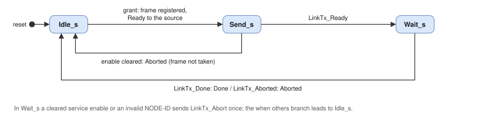

# ocan_dispatch: Architecture and Design Description

## 1. Block diagram

`ocan_dispatch` is one entity with one two-process record. It instantiates `olo_base_arb_rr` for the transmit
arbitration and runs in `Clk`. It has no frame memory (D11 of the [architecture](../../../docs/architecture.md)).

## 2. COB-ID table and protection (DS-4)

`ocan_od` supplies the configured COB-IDs as two copies of a table of 12 entries, `Cfg_CobId` and `Cfg_CobIdCopy`,
with 12 bits per entry. Bit 11 is the valid flag ('1': the object is valid) and bits 10 to 0 are the identifier.

| Entry | Object | Direction |
| --- | --- | --- |
| 0 | SYNC | Receive |
| 1 | Spacecraft Time PDO | Receive |
| 2 to 5 | Receive PDO 1 to 4 | Receive |
| 6 to 9 | Transmit PDO 1 to 4 | Transmit |
| 10 | Local Time PDO | Transmit |
| 11 | Master heartbeat (700h + NODE-ID of the Redundancy Master) | Receive |

A registered flag `Usable(e)` is set for entry e when four conditions hold:

- both copies are equal;
- the valid flag is set;
- the identifier is outside the free ranges 781h to 7DEh and 7F0h to 7FFh (DS-TX-05);
- the entry exists for the generics (`NumRpdo_g`, `NumTpdo_g`, `TimePdos_g`).

`Stat_CobIdMismatch(e)` is the registered inequality of the copies. `Err_CobId` pulses in the cycle in which an
entry becomes unequal (DS-CP-02). An entry that is not usable matches no received frame, and a transmit request of its
object completes as aborted. A change of the configuration takes effect one cycle later.

## 3. Receive filter (DS-1)

One filter per bus classifies the frame of `LinkRx_*(b)` in the cycle of `LinkRx_Valid(b)`. A frame qualifies only
when it is a data frame (`Rtr` = '0') with an 11-bit identifier (`Ide` = '0') and `Nmt_NodeIdValid` is '1'
(DS-RX-02, DS-RX-07). The first match in this order wins:

| Order | Identifier | Class | Further condition |
| --- | --- | --- | --- |
| 1 | 000h | NMT message | DLC 2 and byte 1 = `Nmt_NodeId` or 0; another DLC: protocol error; another node: discarded (DS-RX-03) |
| 2 | Entry 0 | SYNC | - |
| 3 | Entry 11 | Master heartbeat | - |
| 4 | 600h + `Nmt_NodeId` | SDO request | `SdoServer_g` = true |
| 5 | Entries 2 to 5 | Receive PDO 1 to 4 | - |
| 6 | Entry 1 | Spacecraft Time PDO | `TimePdos_g` = true |

The identifier is bits 28 to 18 of `LinkRx_Id`. Bytes beyond the DLC are 0 (partner behaviour of `olo_intf_can`).
The order only matters for a configuration that gives two objects the same identifier, which `ocan_od` rejects for
restricted COB-IDs (6.10b).

## 4. Bus gate (DS-2)

The gate passes the classified frame of the active bus (`Red_ActiveBus`) to the protocol outputs and applies the
service enables (DS-RX-06): SDO requests with `Nmt_EnaSdo`, receive PDOs and the Spacecraft Time PDO with
`Nmt_EnaPdo`, SYNC with `Nmt_EnaSync`. NMT messages and master heartbeats are always passed. The NMT messages and
master heartbeats of both buses go to `ocan_redundancy` in the same cycle, each on its bus index (DS-BG-02).

Held NMT message (DS-BG-03, DS-BG-04):

| Condition | Action |
| --- | --- |
| `Red_Selecting` = '1' and an NMT message on the inactive bus, none on the active bus in the same cycle | `Hold` := '1' with the command specifier and the bus. From this cycle on, no frame of either bus reaches the protocol outputs (the per-bus events to `ocan_redundancy` continue) |
| `Hold` = '1' and `Red_ActiveBus` = the held bus | `RxNmt_Valid` with the held command specifier, `Hold` := '0' |
| `Hold` = '1', `Red_Selecting` = '0' and `Red_ActiveBus` /= the held bus | `Hold` := '0' without an event |
| NMT messages on both buses in the same cycle | The message of the active bus is passed; the other is not held |

The protocol outputs are registered: an event follows `LinkRx_Valid` by one clock cycle for every object and both
buses (DS-RX-05). The held NMT message is the exception; `ocan_redundancy` changes the active bus within a few cycles.

## 5. Transmit arbitration (DS-3)

Sources and their requester bits at `olo_base_arb_rr` (`Width_g` = 7; the left-most bit is served first):

| Bit | Source | Identifier | Service enable |
| --- | --- | --- | --- |
| 6 to 3 | Transmit PDO 1 to 4 | Entries 6 to 9 | `Nmt_EnaPdo` |
| 2 | Local Time PDO | Entry 10 | `Nmt_EnaPdo` |
| 1 | SDO reply | 580h + `Nmt_NodeId` | `Nmt_EnaSdo` |
| 0 | NMT error control (boot-up, heartbeat) | 700h + `Nmt_NodeId` | always |

- **Reject path.** A request whose service enable is clear, whose entry is not usable or that comes while
  `Nmt_NodeIdValid` is '0' does not reach the arbiter. It is answered in the next cycle with `Ready` and `Aborted`
  (DS-TX-04).
- **Arbitration.** The other valid requests form `In_Req`. `olo_base_arb_rr` grants the first requester after the last
  granted one, in the order of the table (DS-TX-01). A pending source therefore waits for at most one frame of each
  other source (DS-TX-06).
- **Frame register.** The register holds one frame (owner, identifier, DLC, eight data bytes).

| State | `LinkTx_Valid` | Exit |
| --- | --- | --- |
| `Idle_s` | '0' | Grant: the frame of the granted source is registered, `Ready` of that source, `Out_Ready` of the arbiter; to `Send_s` |
| `Send_s` | '1' | `LinkTx_Ready` = '1': to `Wait_s`. The service enable of the owner cleared or the NODE-ID invalid: `Aborted` to the owner, to `Idle_s` (the link has not taken the frame) |
| `Wait_s` | '0' | `LinkTx_Done`: `Done` to the owner; `LinkTx_Aborted`: `Aborted` to the owner; to `Idle_s`. The service enable of the owner cleared or the NODE-ID invalid: `LinkTx_Abort` (once) |

The `when others` branch leads to `Idle_s`. The completion events go to the owner of the frame only (DS-TX-03).

**Interface rule.** A source is not granted in the cycle of its own completion event: its requester bit is held
at '0' while `Done` or `Aborted` of that source is '1'. A request of that source waits one clock cycle in this
case. At every transmit port `Ready` together with `Aborted` is therefore the reject path only, and `Ready` never
comes together with `Done`. A protocol block that stops waiting for a taken frame (`ocan_nmt` at a reset
communication or a time-out) may request again at once; the late completion of the old frame cannot be taken for
the completion of the new request. The other protocol blocks rely on the same rule.
The frames are data frames with an 11-bit identifier; `ocan_core` ties `Tx_Ide` and `Tx_Rtr` of `ocan_link` to '0'.

## 6. Ports of ocan_dispatch

| Signal | Direction | Width | Description |
| --- | --- | --- | --- |
| `Clk`, `Rst` | In | 1 | Clock and synchronous high-active reset |
| `LinkRx_Valid` | In | 2 | Frame events of bus A (0) and bus B (1) from `ocan_link` |
| `LinkRx_Id`, `LinkRx_Ide`, `LinkRx_Rtr`, `LinkRx_Dlc`, `LinkRx_Data` | In | 58, 2, 2, 8, 128 | Frame fields per bus, as at `ocan_link` |
| `LinkTx_Valid`, `LinkTx_Ready` | Out, In | 1 | Frame to send to `ocan_link` |
| `LinkTx_Id`, `LinkTx_Dlc`, `LinkTx_Data` | Out | 29, 4, 64 | Identifier in bits 28 to 18 (bits 17 to 0 are 0), DLC, data |
| `LinkTx_Abort` | Out | 1 | Pulse: abort the pending frame |
| `LinkTx_Done`, `LinkTx_Aborted` | In | 1 | Completion events of `ocan_link` |
| `Red_ActiveBus`, `Red_Selecting` | In | 1 | Active bus and bus selection process from `ocan_redundancy` |
| `Nmt_NodeId`, `Nmt_NodeIdValid` | In | 7, 1 | NODE-ID and its validity from `ocan_nmt` |
| `Nmt_EnaSdo`, `Nmt_EnaPdo`, `Nmt_EnaSync` | In | 1 | Service enables from `ocan_nmt` |
| `Cfg_CobId`, `Cfg_CobIdCopy` | In | 144 | Two copies of the COB-ID table (section 2) from `ocan_od` |
| `RxNmt_Valid`, `RxNmt_Cs` | Out | 1, 8 | NMT message to `ocan_nmt` (command specifier) |
| `RxSync_Valid`, `RxSync_Dlc`, `RxSync_Data` | Out | 1, 4, 8 | SYNC to `ocan_pdo` and `ocan_time` (counter byte) |
| `RxRpdo_Valid`, `RxRpdo_Num`, `RxRpdo_Dlc`, `RxRpdo_Data` | Out | 1, 2, 4, 64 | Receive PDO 1 to 4 (number 0 to 3) to `ocan_pdo` |
| `RxTime_Valid`, `RxTime_Dlc`, `RxTime_Data` | Out | 1, 4, 64 | Spacecraft Time PDO to `ocan_time` |
| `RxSdo_Valid`, `RxSdo_Dlc`, `RxSdo_Data` | Out | 1, 4, 64 | SDO request to `ocan_sdo` |
| `RxRed_NmtValid`, `RxRed_HbValid` | Out | 2 | Per bus: NMT message, master heartbeat (to `ocan_redundancy`) |
| `RxRed_HbDlc`, `RxRed_HbState` | Out | 8, 16 | Per bus: DLC and state byte of the master heartbeat |
| `TxTpdo_Valid`, `TxTpdo_Ready` | In, Out | 4 | Transmit PDO 1 to 4 requests from `ocan_pdo` |
| `TxTpdo_Dlc`, `TxTpdo_Data` | In | 16, 256 | Per transmit PDO: DLC and data |
| `TxTpdo_Done`, `TxTpdo_Aborted` | Out | 4 | Per transmit PDO: completion |
| `TxTime_Valid`, `TxTime_Ready`, `TxTime_Dlc`, `TxTime_Data`, `TxTime_Done`, `TxTime_Aborted` | In, Out, In, In, Out, Out | 1, 1, 4, 64, 1, 1 | Local Time PDO from `ocan_time` |
| `TxSdo_Valid`, `TxSdo_Ready`, `TxSdo_Dlc`, `TxSdo_Data`, `TxSdo_Done`, `TxSdo_Aborted` | In, Out, In, In, Out, Out | 1, 1, 4, 64, 1, 1 | SDO reply from `ocan_sdo` |
| `TxNmt_Valid`, `TxNmt_Ready`, `TxNmt_Data`, `TxNmt_Done`, `TxNmt_Aborted` | In, Out, In, Out, Out | 1, 1, 8, 1, 1 | NMT error control (boot-up, heartbeat; DLC 1) from `ocan_nmt` |
| `Err_Protocol` | Out | 1 | Event: NMT frame with a DLC other than 2 |
| `Err_CobId` | Out | 1 | Event: a COB-ID entry became unequal |
| `Stat_CobIdMismatch` | Out | 12 | Per entry: the copies differ |

Byte 0 of every data field is in the top byte (bits 63 to 56), as at `olo_intf_can`.

## 7. Configuration parameters

| Generic | Default | Range | Description |
| --- | --- | --- | --- |
| `NumRpdo_g` | 4 | 0 to 4 | Receive PDOs; entries above it are not usable |
| `NumTpdo_g` | 4 | 0 to 4 | Transmit PDOs; requests of others are rejected |
| `TimePdos_g` | true | true, false | Entries 1 and 10 |
| `SdoServer_g` | true | true, false | SDO requests classified and SDO replies served |

## 8. Timing and behaviour

| Operation | Duration |
| --- | --- |
| `LinkRx_Valid` to a protocol output or a per-bus event | 1 clock cycle |
| Held NMT message to `RxNmt_Valid` | 1 clock cycle after `Red_ActiveBus` has changed to its bus |
| Request to `LinkTx_Valid` (no frame pending) | 1 clock cycle (grant and frame register in the cycle of the request) |
| Completion of the link to `Done` or `Aborted` of the owner | 1 clock cycle |
| Rejected request to `Ready` and `Aborted` | 1 clock cycle |
