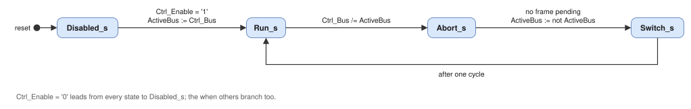

# ocan_link: Architecture and Design Description

## 1. Block diagram


`ocan_link` is one entity. The blocks LK-2 to LK-6 are processes of its two-process record; LK-1 is one or two
instances of `olo_intf_can` (generate on `BusAccess_g`). Everything runs in `Clk`; the bus inputs reach the
synchronisers of `olo_intf_can` (`SyncStages_g`, `SyncTmr_g` = true).

Indices: the signals of a bus (`Can_*`, `Rx_*`) have index 0 for bus A and 1 for bus B. The signals of a controller
(`Stat_*`, `Err_*`, `Ctrl_Reenable`, `ErrInj_TxDominant`) have index 0 for controller 0 and 1 for controller 1.
Controller 0 is the only controller with selective bus access and the controller of bus A with parallel bus access.
Controller 1 exists with parallel bus access only, on bus B. Without it, its status outputs are constant: counts 0,
error active, bus not idle, no events.

## 2. Controllers and bus selector (LK-1, LK-2)

| `BusAccess_g` | Controller 0 | Controller 1 | `Can_Rx` of a controller | `Can_Tx`, `Can_TxEn` of the inactive bus |
| --- | --- | --- | --- | --- |
| "Selective" | Normal mode, on the active bus | Not present | `Can_Rx(ActiveBus)` | '1', '0' |
| "Parallel" | Bus A; normal mode when A is active, listen-only otherwise | Bus B; normal mode when B is active, listen-only otherwise | `Can_Rx(c)` | '1', '0' |

The selector (selective bus access) switches the receive input of controller 0 only while the controller is
disabled (state `Switch_s` or `Disabled_s`), so a glitch of the multiplexer never reaches an enabled controller.
`Cfg_ListenOnly` of each controller follows the registered active bus, which also changes only while the
controllers are disabled. `Cfg_Loopback` is '0'. The bit timing inputs go to both controllers unchanged; they are
static while `Ctrl_Enable` is '1'.

Bus outputs, for bus b:

```text
Can_Tx(b)   = TxInt(c) when b = ActiveBus and Live(c) else '1'
Can_TxEn(b) = '1'      when b = ActiveBus and Live(c) else '0'
Live(c)     = (State = Run_s or State = Abort_s) and not Stopped(c)
TxInt(c)    = Can_Tx of controller c and not ErrInj_TxDominant(c)      ('0' is dominant)
```

c is the controller on bus b: controller 0 with selective bus access, controller b with parallel bus access. The
outputs of the inactive bus are recessive in every state, so a listen-only controller never drives its bus (D4 of the
[architecture](../../../docs/architecture.md)), also not under fault injection.

## 3. Bus switch sequencer (LK-3)



| State | `Cfg_Enable` of the controllers | `Tx_Abort` to the controllers | `Tx_Ready` | Exit |
| --- | --- | --- | --- | --- |
| `Disabled_s` | '0' | '1' (drops a pending frame) | '0' | `Ctrl_Enable` = '1': `ActiveBus` := `Ctrl_Bus`, to `Run_s` |
| `Run_s` | '1' for every controller that is not stopped | `Tx_Abort` of the user | as the active controller, while it is not stopped | `Ctrl_Bus` /= `ActiveBus`: to `Abort_s` |
| `Abort_s` | '1' for every controller that is not stopped | '1' | '0' | No frame pending in the active controller: `ActiveBus` := not `ActiveBus`, to `Switch_s` |
| `Switch_s` | '0' | '0' | '0' | After one cycle: to `Run_s` |

- `Ctrl_Enable` = '0' leads from every state to `Disabled_s` and clears the stopped flags of LK-6 (LK-DT-02).
- `Tx_Abort` is held during `Abort_s`. `olo_intf_can` drops a pending frame that is not on the bus at once. A frame
  that is on the bus completes (`Tx_Done`) or is dropped after its attempt (`Tx_Aborted`). "No frame pending" is the
  `Tx_Ready` of the active controller.
- In `Disabled_s` the controllers are disabled and `Tx_Abort` is set. A frame that was pending at the disable is
  dropped and reported with `Tx_Aborted`, so it is never sent after the next enable (section 5 of the
  [specification](specification.md)).
- `Switch_s` lasts one clock cycle. The new active bus is registered on entry, so the selector and the modes change in
  a cycle in which every controller is disabled. In `Run_s` the controllers integrate (11 recessive bits) before they
  receive or send.
- A request that changes during `Abort_s` or `Switch_s` does not stop the switch. Back in `Run_s` the comparison
  starts the next switch when the request differs from the new active bus (LK-BS-05).
- The `when others` branch leads to `Disabled_s`.

`Stat_ActiveBus` is the registered active bus; `Stat_Switching` is '1' in `Abort_s` and `Switch_s`.

## 4. Receive path (LK-4)

`Rx_Valid` of controller c is registered, with the frame fields, into the receive outputs of the bus of the
controller: `Rx_*(ActiveBus)` for controller 0 with selective bus access, `Rx_*(c)` with parallel bus access. The
latency is one clock cycle after `Rx_Valid` of `olo_intf_can`, the same for both buses (LK-RX-01). Both buses can have
an event in the same cycle (LK-RX-02). There is no back pressure and no buffer (D11).

## 5. Transmit path (LK-5)

`Tx_Valid` and the frame fields go to the controller of the active bus; `Tx_Ready` is the `Tx_Ready` of that
controller in `Run_s` while it is not stopped, and '0' otherwise (LK-TX-01, LK-DT-03). `Tx_Done`, `Tx_Aborted` and
`Tx_ArbLost` are the OR of both controllers: only the active controller can have a pending frame, because the
sequencer aborts it before the active bus changes. `Tx_Abort` of the user goes to the active controller in `Run_s`.

## 6. Dominant monitor (LK-6)

One monitor per controller observes `TxInt(c)`, the transmit bit of the controller with the fault injection of
`ErrInj_TxDominant(c)`. It counts bit times while `TxInt(c)` is dominant:

- a time quantum counter of `Cfg_Prescaler` clock cycles (0 counts as 1, as in `olo_intf_can`);
- a quantum counter of 1 + `Cfg_Tseg1` + `Cfg_Tseg2` quanta per bit;
- a bit counter up to `DominantLimit_g`.

All three restart when `TxInt(c)` is recessive. When the bit counter reaches `DominantLimit_g`, the monitor sets
`Stopped(c)`, pulses `Err_DomTimeout(c)` and requests the abort of a pending frame of the controller (LK-DT-01). With
`Stopped(c)`, the controller is disabled (`Cfg_Enable` = '0') and `Live(c)` is false, so its bus outputs are
recessive and its transmit enable is '0'. `Stat_DomTimeout(c)` is `Stopped(c)`. A pulse on `Ctrl_Reenable(c)` or the
state `Disabled_s` clears it (LK-DT-02).

No multiplier is needed: the counters follow the bit timing inputs, which are static while the link is enabled. The
accuracy is one bit time, which does not matter against the margin of the limit (specification, section 5).

## 7. Ports of ocan_link

| Signal | Direction | Width | Default | Description |
| --- | --- | --- | --- | --- |
| `Clk`, `Rst` | In | 1 | - | Clock and synchronous high-active reset |
| `Ctrl_Enable` | In | 1 | - | '1': the link takes part in the buses (`ocan_nmt`: NODE-ID valid, clause 6.10f) |
| `Ctrl_Bus` | In | 1 | - | Requested active bus, '0' bus A, '1' bus B (`ocan_redundancy`) |
| `Ctrl_Recover` | In | 1 | '0' | Pulse: start the bus-off recovery (`AutoRecover_g` = false only) |
| `Ctrl_Reenable` | In | 2 | "00" | Pulse per controller: re-enable after a dominant timeout |
| `Cfg_Prescaler`, `Cfg_Tseg1`, `Cfg_Tseg2`, `Cfg_Sjw` | In | 10, 5, 4, 3 | - | Bit timing of both controllers, as at `olo_intf_can`; static while `Ctrl_Enable` = '1' |
| `Tx_Valid`, `Tx_Ready` | In, Out | 1 | '0', - | Handshake of the frame to send |
| `Tx_Id`, `Tx_Ide`, `Tx_Rtr`, `Tx_Dlc`, `Tx_Data` | In | 29, 1, 1, 4, 64 | 0 | Frame to send, as at `olo_intf_can` (standard identifier in bits 28 to 18, byte 0 in bits 63 to 56) |
| `Tx_Abort` | In | 1 | '0' | Pulse: abort the pending frame |
| `Tx_Done`, `Tx_Aborted`, `Tx_ArbLost` | Out | 1 | - | Events of the pending frame |
| `Rx_Valid` | Out | 2 | - | Event per bus: a frame was received on bus A (0) or bus B (1) |
| `Rx_Id`, `Rx_Ide`, `Rx_Rtr`, `Rx_Dlc`, `Rx_Data` | Out | 58, 2, 2, 8, 128 | - | Frame fields per bus (bus b in slice b); valid with `Rx_Valid(b)` |
| `Stat_ActiveBus`, `Stat_Switching` | Out | 1 | - | Active bus; '1' during a bus switch |
| `Stat_Tec`, `Stat_Rec`, `Stat_State`, `Stat_BusIdle` | Out | 18, 16, 4, 2 | - | Per controller (9, 8, 2 and 1 bits each), as at `olo_intf_can` |
| `Stat_DomTimeout` | Out | 2 | - | Per controller: '1' while stopped by the dominant monitor |
| `Err_Bit`, `Err_Stuff`, `Err_Crc`, `Err_Form`, `Err_Ack` | Out | 2 | - | Error events per controller, as at `olo_intf_can` |
| `Err_DomTimeout` | Out | 2 | - | Event per controller: dominant timeout |
| `ErrInj_TxDominant` | In | 2 | "00" | **Test input.** '1' forces the transmit bit of the controller dominant ahead of the dominant monitor (LK-IF-07). A system ties it to "00" or drives it in test only |
| `Can_Tx`, `Can_TxEn` | Out | 2 | - | Per bus: transmit bit to the transceiver ('1' recessive) and its transmit enable |
| `Can_Rx` | In | 2 | "11" | Per bus: receive bit from the transceiver ('1' recessive) |

## 8. Configuration parameters

| Generic | Default | Range | Description |
| --- | --- | --- | --- |
| `BusAccess_g` | "Selective" | "Selective", "Parallel" | Bus access architecture; an assertion rejects other values |
| `SyncStages_g` | 2 | 2 to 4 | Synchroniser stages of `olo_intf_can` |
| `AutoRecover_g` | true | true, false | Bus-off recovery of `olo_intf_can` |
| `DominantLimit_g` | 32 | 13 to 1023 | Limit of the dominant monitor in bit times |

## 9. Timing and behaviour

| Operation | Duration |
| --- | --- |
| Received frame to `Rx_Valid` | 1 clock cycle after `Rx_Valid` of `olo_intf_can` |
| Bus switch without a pending frame | 2 clock cycles (`Abort_s`, `Switch_s`), then 11 recessive bits of integration |
| Bus switch with a frame on the bus | Up to the end of the frame or of its error frame on the old bus, then as above |
| Enable to the first bit | 1 clock cycle, then 11 recessive bits of integration |
| Dominant timeout | `DominantLimit_g` bit times, plus at most one bit time, after the transmit bit became dominant |

## 10. Integration notes

- `ErrInj_TxDominant` is a test input: tie it to "00" in a system, or drive it from a test interface only. It forces
  a bus dominant for up to `DominantLimit_g` bit times before the monitor releases it.
- `Can_TxEn` drives the transmit enable of an ISO 11898-2 transceiver (standby or silent pin through the polarity of
  the board) or gates the driver enable of an RS-485 transceiver, whose DI and DE take the inverted `Can_Tx` (clause
  5.3.6a, on the board).
- The bit timing is chosen for the network by the integrator (clause 5.4.3b, c); `canBitTiming` of `olo_intf_pkg_can`
  computes a setting for a clock frequency and a bit rate.
