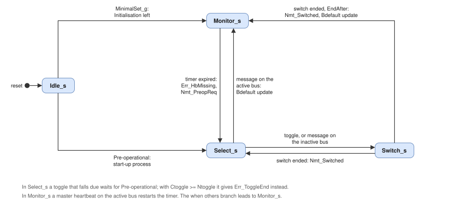

# ocan_redundancy: Architecture and Design Description

## 1. Block diagram

`ocan_redundancy` is one entity with one two-process record. It instantiates no other entity and runs in `Clk`. The
encoding of `Nmt_State` is the NMT state encoding of `ocan_pkg` ("00" Initialisation, "01" Pre-operational, "10"
Operational, "11" Stopped; architecture of `ocan_nmt`, section 3).

## 2. Master heartbeat consumer (RM-1)

### 2.1 Heartbeat check

A master heartbeat on bus b is `Rx_HbValid(b)` with DLC 1 (RM-HB-01). An event with another DLC is ignored and gives
`Err_HbDlc`; events of both buses in one cycle give one pulse. The state byte is not checked. `Stat_HbState` holds
the state byte of the last master heartbeat on the active bus. An NMT message on bus b is `Rx_NmtValid(b)`; the
dispatch has checked its DLC and addressing (DS-RX-03).

### 2.2 Presence per bus

Per bus a counter `PresMs(b)` (16 bits) and a flag `Present(b)` (`Stat_HbPresent(b)`, RM-HB-05):

| Condition | `PresMs(b)` | `Present(b)` |
| --- | --- | --- |
| `Cfg_HbTime` = 0 | 0 | '0' |
| Master heartbeat on bus b | 0 | '1' |
| `Tick_Ms`, `Present(b)` = '1' and `PresMs(b)` = `Cfg_HbTime` - 1 | 0 | '0' |
| `Tick_Ms` and `Present(b)` = '1' | `PresMs(b)` + 1 | '1' |

### 2.3 Timer

One timer serves the master heartbeat monitoring in `Monitor_s` and the toggling in `Select_s` and `Switch_s`. It
counts Ttoggle consumer heartbeat times with two counters, so that no multiplier is needed. T is `Cfg_Ttoggle`, read
as 1 when it is 0 (RM-HB-04); C is `Cfg_HbTime`.

| Register | Width | Function |
| --- | --- | --- |
| `TmrMs` | 16 | Ticks within the current consumer heartbeat time, 0 to C - 1 |
| `TmrPer` | 8 | Consumer heartbeat times elapsed, 0 to T - 1 |
| `HbTimeReg`, `TtoggleReg` | 16, 8 | `Cfg_HbTime` and `Cfg_Ttoggle` of the previous cycle |

At `Tick_Ms` with C /= 0, while the state is `Monitor_s`, `Select_s` or `Switch_s`: when `TmrMs` = C - 1, `TmrMs`
:= 0 and `TmrPer` is incremented; when `TmrPer` is T - 1 at that point, `TmrPer` := 0 and the timer **expires**.
The timer expires every T x C ticks. With C = 0 it never expires (RM-HB-03).

A **restart** clears both counters. It happens at every master heartbeat on the active bus in `Monitor_s`, at the
start and at the end of a bus selection process, at a toggle, and when `Cfg_HbTime` /= `HbTimeReg` or
`Cfg_Ttoggle` /= `TtoggleReg` (RM-HB-04). A restart and a tick in the same cycle restart the timer; the tick is not
counted. The first expiry after a restart therefore lies between T x C - 1 and T x C milliseconds after it.

## 3. Bus selection process (RM-2)

| Register | Width | Content |
| --- | --- | --- |
| `Fsm` | - | `Idle_s`, `Monitor_s`, `Select_s`, `Switch_s` |
| `ReqBus` | 1 | Requested active bus (`Link_Bus`) |
| `Ctoggle` | 8 | Toggles of the current process (`Stat_Ctoggle`) |
| `ToggleDue` | 1 | A toggle has fallen due and waits for Pre-operational |
| `Exhausted` | 1 | The end of the toggling was reported (`Err_ToggleEnd`), no further event until the next toggle |
| `EndAfter` | 1 | The running switch ends the process (RM-SL-06) |

`Stat_Selecting` is '1' in `Select_s` and `Switch_s`. `Stat_ActiveBus` is `Link_ActiveBus` (RM-IF-04). The link
has ended a switch when `Link_Switching` = '0' and `Link_ActiveBus` = `ReqBus`.

A message on bus b is a master heartbeat (section 2.1) or an NMT message on bus b. The active bus is
`Link_ActiveBus`; the other bus is the inactive one.

| State | Condition (first match) | Action | Next state |
| --- | --- | --- | --- |
| `Idle_s` | `MinimalSet_g` = false and `Nmt_State` = Pre-operational | Start-up process on Bdefault, no switch (RM-SL-01): `Ctoggle` := 0, restart | `Select_s` |
| `Idle_s` | `MinimalSet_g` = true and `Nmt_State` /= Initialisation | Monitoring starts (RM-MS-02): restart | `Monitor_s` |
| `Idle_s` | otherwise | `ReqBus` := `Cfg_Bdefault` | `Idle_s` |
| `Monitor_s` | Timer expired | `Err_HbMissing`, `Nmt_PreopReq` (RM-HB-02, RM-SL-02); `Ctoggle` := 0, `ToggleDue` := '1', `Exhausted` := '0', restart | `Select_s` |
| `Select_s` | Message on the active bus | End of the process (RM-SL-05): `Upd_Valid` with `Upd_Bdefault` = `Link_ActiveBus`, restart | `Monitor_s` |
| `Select_s` | Message on the inactive bus only | `ReqBus` := the inactive bus, `EndAfter` := '1' (RM-SL-06); `Ctoggle` unchanged | `Switch_s` |
| `Select_s` | `ToggleDue` = '1', `Nmt_State` = Pre-operational and `Ctoggle` < `Cfg_Ntoggle` | Toggle (RM-SL-03): `ReqBus` := not `ReqBus`, `Ctoggle` + 1, `ToggleDue` := '0', `Exhausted` := '0', restart | `Switch_s` |
| `Select_s` | `ToggleDue` = '1' and `Ctoggle` >= `Cfg_Ntoggle` | `ToggleDue` := '0'; `Err_ToggleEnd` when `Exhausted` = '0', then `Exhausted` := '1' (RM-SL-04) | `Select_s` |
| `Select_s` | Timer expired | `ToggleDue` := '1' | `Select_s` |
| `Switch_s` | The link has ended the switch, `EndAfter` = '1' | `Nmt_Switched`; end of the process: `Upd_Valid` with `Upd_Bdefault` = `ReqBus`, `EndAfter` := '0', restart | `Monitor_s` |
| `Switch_s` | The link has ended the switch | `Nmt_Switched` (RM-SL-03) | `Select_s` |
| `Switch_s` | Master heartbeat or NMT message on the bus `ReqBus` | `EndAfter` := '1' | `Switch_s` |
| `Switch_s` | Timer expired | `ToggleDue` := '1' | `Switch_s` |

The `when others` branch leads to `Monitor_s` with a restart: the node keeps its bus, and a missing master heartbeat
starts a new bus selection.

- **Same-cycle messages.** A message on the active bus wins over one on the inactive bus in the same cycle
  (RM-SL-06, DS-BG-04).
- **Outside the bus selection process** messages of the inactive bus change nothing but the presence status
  (RM-SL-07). In `Monitor_s` a master heartbeat on the active bus restarts the timer; NMT messages do not.
- **Writes** (RM-SL-09, RM-SL-10). `Cfg_Bdefault` is read in `Idle_s` only. `Cfg_CtoggleWr` loads `Cfg_Ctoggle`
  into `Ctoggle` in any state, without a restart; a write in the same cycle as a toggle wins. `Cfg_Ntoggle` is
  compared at every toggle that falls due. The toggle inverts `ReqBus`, so after an even number of toggles the node
  is on the bus on which the process started.
- **NMT resets** do not reach `ocan_redundancy` (RM-SL-08). After a reset communication `ocan_nmt` passes the
  Initialisation again: a toggle that falls due meanwhile waits in `ToggleDue` (RM-SL-03).

## 4. Ports of ocan_redundancy

| Signal | Direction | Width | Description |
| --- | --- | --- | --- |
| `Clk`, `Rst` | In | 1 | Clock and synchronous high-active reset |
| `Tick_Ms` | In | 1 | Pulse every millisecond (`olo_base_strobe_gen` of `ocan_core`) |
| `Rx_NmtValid` | In | 2 | Per bus: NMT message (`RxRed_NmtValid` of `ocan_dispatch`) |
| `Rx_HbValid`, `Rx_HbDlc`, `Rx_HbState` | In | 2, 8, 16 | Per bus: master heartbeat, its DLC and state byte (`RxRed_Hb*` of `ocan_dispatch`) |
| `Cfg_HbTime` | In | 16 | Consumer heartbeat time of the master in milliseconds (1016h sub-index 1, bits 15 to 0) |
| `Cfg_Bdefault` | In | 1 | Bdefault (2000h sub-index 1): '0' bus A, '1' bus B |
| `Cfg_Ttoggle`, `Cfg_Ntoggle` | In | 8, 8 | Ttoggle and Ntoggle (2000h sub-indices 2 and 3) |
| `Cfg_CtoggleWr`, `Cfg_Ctoggle` | In | 1, 8 | Write of Ctoggle (2000h sub-index 4): pulse and value |
| `Upd_Valid`, `Upd_Bdefault` | Out | 1, 1 | Update of Bdefault at the end of a bus selection process (clause 8.3.3l), to `ocan_od` |
| `Link_Bus` | Out | 1 | Requested active bus (`Ctrl_Bus` of `ocan_link`) |
| `Link_ActiveBus`, `Link_Switching` | In | 1 | `Stat_ActiveBus` and `Stat_Switching` of `ocan_link` |
| `Nmt_State` | In | 2 | NMT state (`Stat_State` of `ocan_nmt`, encoding of `ocan_pkg`) |
| `Nmt_PreopReq`, `Nmt_Switched` | Out | 1 | Pulses to `ocan_nmt` (`Red_PreopReq`, `Red_Switched`) |
| `Stat_ActiveBus` | Out | 1 | Active bus reported by the link (`Red_ActiveBus` of `ocan_dispatch`) |
| `Stat_Selecting` | Out | 1 | '1' during the bus selection process (`Red_Selecting` of `ocan_dispatch` and `ocan_nmt`) |
| `Stat_Ctoggle` | Out | 8 | Ctoggle, for reads of 2000h sub-index 4 |
| `Stat_HbState` | Out | 8 | State byte of the last master heartbeat on the active bus |
| `Stat_HbPresent` | Out | 2 | Per bus: a master heartbeat arrived within the last consumer heartbeat time |
| `Err_HbMissing` | Out | 1 | Event: master heartbeat missing for Ttoggle consumer heartbeat times |
| `Err_ToggleEnd` | Out | 1 | Event: Ntoggle toggles made without an active bus |
| `Err_HbDlc` | Out | 1 | Event: master heartbeat with a DLC other than 1 |

## 5. Configuration parameters

| Generic | Default | Range | Description |
| --- | --- | --- | --- |
| `MinimalSet_g` | false | true, false | Minimal protocol set of clause 9: no start-up bus selection (`Idle_s` to `Monitor_s`) |

## 6. Timing and behaviour

| Operation | Duration |
| --- | --- |
| `Rx_*` event to the action of section 3 (`Upd_Valid`, `Link_Bus`, `Stat_Selecting`) | 1 clock cycle |
| Timer expiry in `Monitor_s` to `Err_HbMissing` and `Nmt_PreopReq` | 1 clock cycle after the tick |
| `Nmt_State` = Pre-operational to `Link_Bus` of the first toggle | 1 clock cycle |
| End of the switch at the link to `Nmt_Switched` | 1 clock cycle |
| Missing master heartbeat | Between T x C - 1 and T x C ms after the last master heartbeat on the active bus |
| Toggle period | T x C ms from a toggle to the next due toggle, the switch time of the link included |

Every event of `ocan_dispatch` is processed in the cycle after it, also events of both buses in one cycle and in
consecutive cycles (RM-IF-08).
